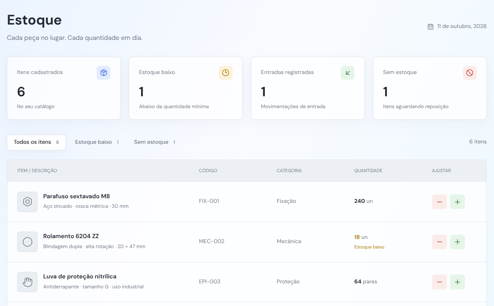
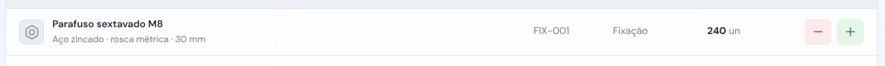
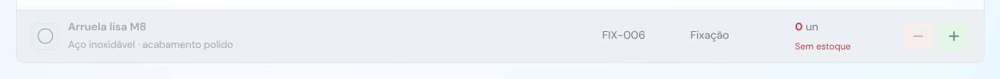
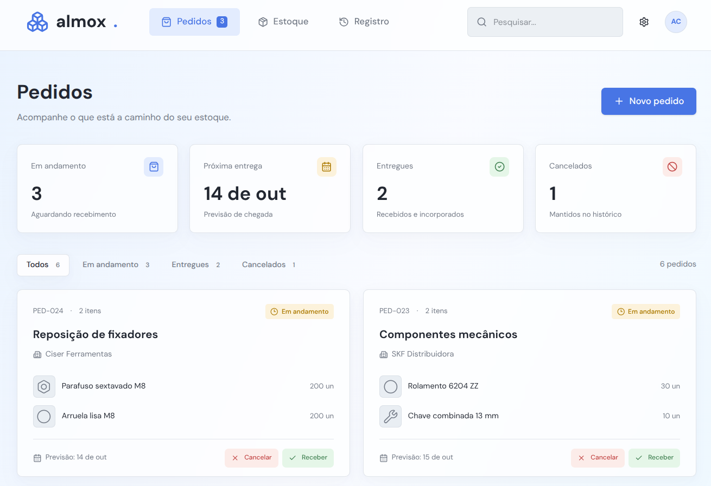
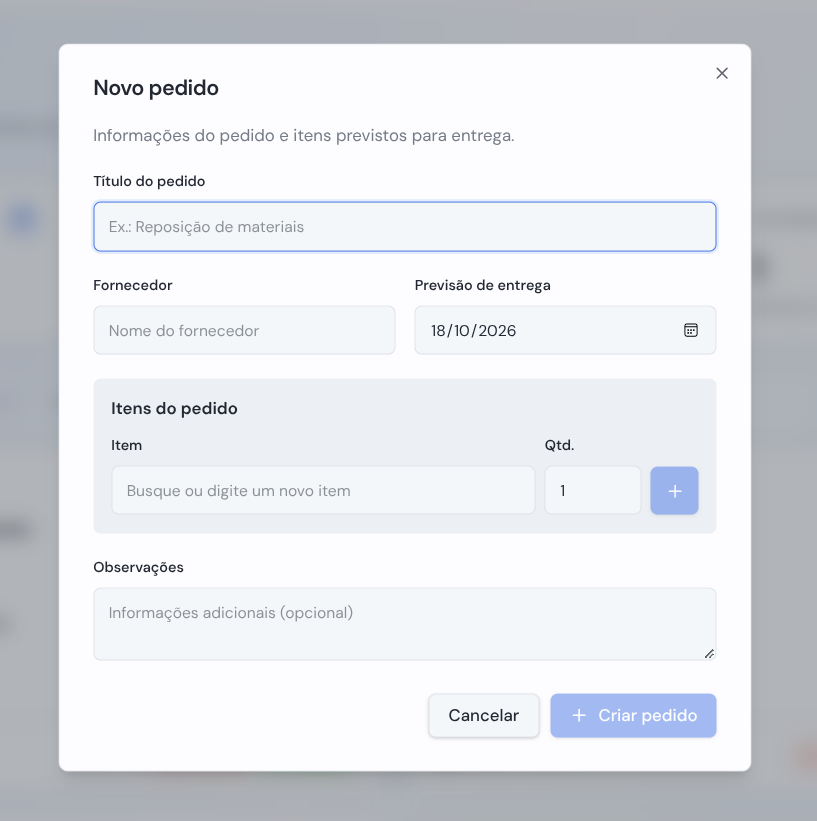
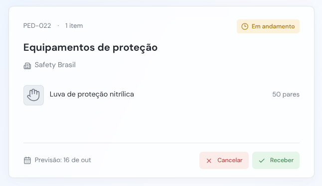
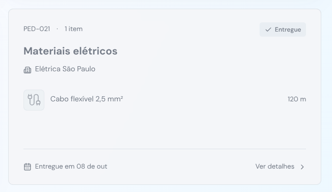
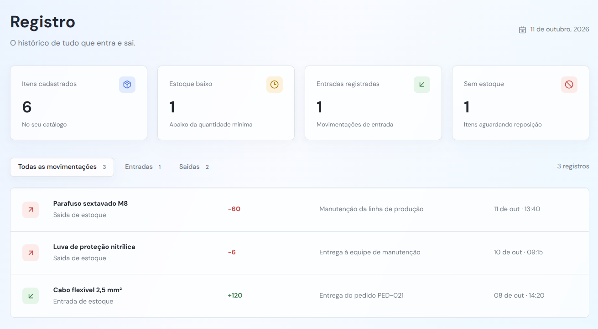
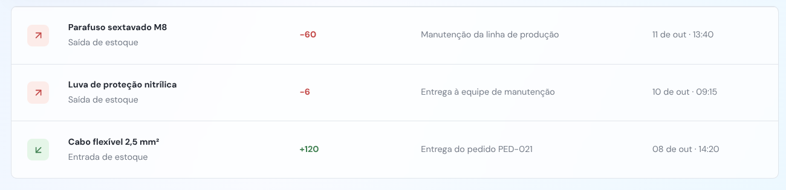

# Modelos da Interface Gráfica

## Estoque

    

    Seção Estoque (Geral)
    

    

    

    Seção Estoque — Item Individual
    

    

    

    Seção Estoque — Item Individual (Estado Cancelado/Recebido):
    

    

## Pedidos

    

    Seção Pedidos (Geral)
    

    

    

    Seção Pedidos — Modal de criação (Exemplo)
    

    

    

    Seção Pedidos — Modal de visualização (Exemplo)
    

    

    

    Seção Pedidos — Item Individual (Estado Padrão)
    

    

    

    Seção Pedidos — Item Individual (Estado Cancelado/Recebido)
    

    

## Registro

    

    Seção Registro
    

    

    

    Seção Registro — Item individual (Estado Padrão)
    

    

